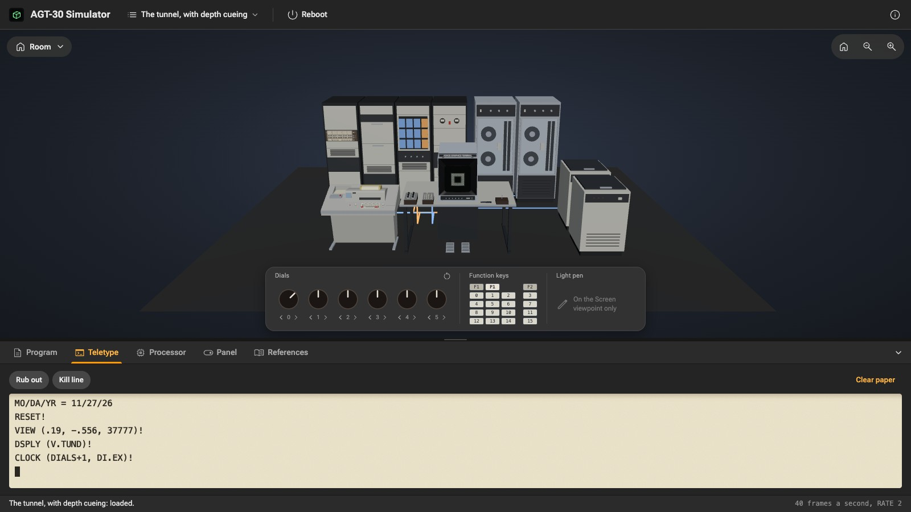
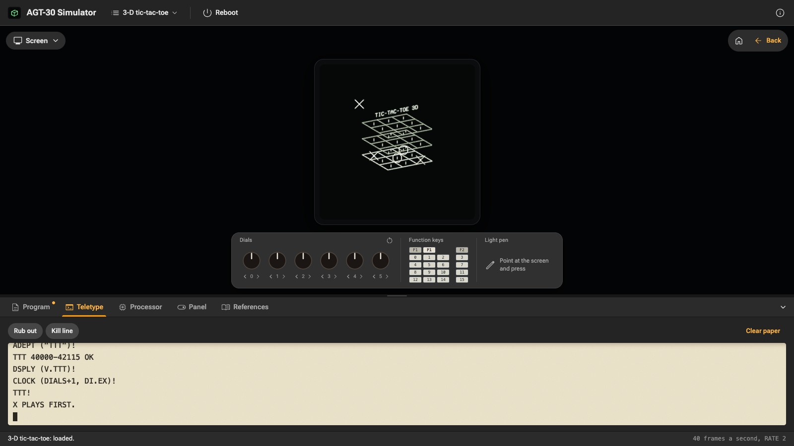
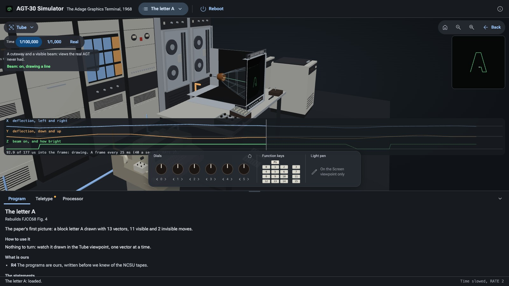

# AGT-30 Simulator

[](https://github.com/wixette/agt30-simulator/actions/workflows/test.yml)

The Adage Graphics Terminal, model 30 (1968), in your browser: a 30-bit processor that walked a structured picture every frame, a hybrid analog array that turned it in three dimensions in under 4 microseconds a point, and a refreshed vector CRT, with its console and its Teletype.

> **A pre-release (v0.0.2).** The simulator is still changing. Its links (`#view=…&program=…`) may change before 1.0.0, and where the documents stop it reconstructs, as listed below.

**[▶ Try it online](https://wixette.github.io/agt30-simulator/)**: nothing to install. Made for a desktop browser (recent Chrome, Edge, Safari or Firefox), and it works on a phone too.



<table>
<tr>
<td width="50%"><b>The Screen</b>: the picture close up, here 3-D tic-tac-toe in play, the marks placed with the light pen.<br></td>
<td width="50%"><b>The Tube</b>: the scope cut open, time slowed 100,000 times, the beam drawing the letter A, with its X, Y and Z signals below.<br></td>
</tr>
</table>

## Quick start

1. **Choose a program** from **Programs** in the top bar, for example *A cube turned by the dials*. The simulator types its statements on the Teletype, as an operator would have, and the picture appears on the scope.
2. **Play with it:** turn the dials in the console strip under the picture (drag one round, or click its small arrows). Each program's card, in the **Program** tab below, says what to try.
3. **Look closer:** the menu at the top left of the picture changes the viewpoint (Room, Console, Screen, Tube). Click any part of the installation for its card.
4. **Start again:** **Unload** on the program's card, or at the foot of the Programs menu, takes the program out and reboots the terminal; **Reboot** in the top bar does the same at any time.

## The machine in a few minutes

The AGT-30 was a graphics terminal made by Adage, Inc. of Boston in 1968: a room of equipment for drawing and turning three-dimensional pictures in real time, decades before graphics cards. It worked very differently from a computer today. These are the ideas the simulator shows, with the nearest thing today; [docs/agt30-overview.md](docs/agt30-overview.md) explains the whole machine.

| Then | What it was | The nearest thing today |
|---|---|---|
| **The vector CRT** (the scope) | A cathode-ray tube whose electron beam draws straight lines from point to point, like a pen, instead of sweeping out rows of pixels. There is no frame buffer: a line glows only for a moment after the beam passes. | An oscilloscope; a laser light show |
| **Refresh** | So every picture is drawn again and again, about 40 times a second. A picture with too many lines no longer fits in one refresh, and flickers. | A game's frame rate |
| **The image** | A picture lives in memory as a structured list: move here, draw a line to there, turn by this angle, draw that sub-picture. | A scene graph, or an SVG file |
| **DSPLY** | The program that walks the image every frame and sends each line to the scope. | A graphics driver |
| **The hybrid array** | An analog computer, built of amplifiers, that rotates, scales and moves each point in under 4 microseconds. It is the AGT's speed. | A GPU's vertex shader |
| **The DPR-2** | The processor: 30-bit words, 32,768 of them in magnetic core memory, about 250,000 instructions a second. Numbers are written in octal (base 8), and negative numbers in one's complement, so there is a −0. | A small microcontroller |
| **The Teletype** (ASR-35) | A printing terminal: a keyboard and a roll of paper, upper case only, 10 characters a second. | A terminal window |
| **AMOS** (its monitor, AMRMX) | The operating system's command interpreter. A statement ends with `!`, such as `DSPLY (V.CUBE, 2)!`, "display the picture V.CUBE". | A shell, such as bash |
| **ADEPT** | The assembler, which turns a program's source into the processor's instructions. | An assembler |
| **The dials, keys and light pen** | Six knobs, sixteen function keys, and a pen that sees the beam pass under it to pick what is drawn there. | Sliders, buttons and a touch screen |

## Using the simulator

**The stage** is the installation in 3D. Its viewpoints:
- **Room:** the whole installation: the desk and scope, the Teletype, the racks, the tape and disk drives, and the cables between them.
- **Console:** from the operator's seat.
- **Screen:** the picture close up. This is where the light pen works.
- **Tube:** the scope cut open, the beam drawing in time slowed up to 100,000 times, with its X, Y and Z signals traced.

**The console strip**, under the picture, holds the dials, the function keys and the light pen.

**The dock** below has four tabs. Drag the handle above it to make it taller or shorter; it remembers its tab and height.
- **Program:** the program loaded: what it rebuilds, how to use it, its switches, what in it is ours, and its statements and source.
- **Teletype:** the paper and the keyboard. Click the paper and type statements yourself, each ended with `!`. Some to try:
  - `DSPLY (V.A)!` shows the letter A; `HALT!` stops the display.
  - `V!` asks the monitor its version.
  - `LIST (, RVCD, RVCD+5)!` lists six words of memory in octal.
- **Processor:** a look inside the processor as it runs: its registers, and memory read as instructions, as picture items or as plain words. A view the real AGT never had.
- **References:** where to read more: the history of the NCSU lab, Adage's documents, the tapes of the NCSU lab, and the simulator's own research. About's References button opens it too.

**Seven programs**, from the Programs menu:
- the letter A, the 1968 paper's first picture;
- a cube turned by the dials, and the same cube in perspective, worked out by the processor;
- the tunnel, with and without depth cueing;
- a town built from one house;
- 3-D tic-tac-toe, played with the function keys and the light pen;
- 1,000 random lines, the paper's measure of the array, which you can push until the picture no longer fits a frame.

**A link** opens a viewpoint and a program: for example [`#view=screen&program=tic-tac-toe`](https://wixette.github.io/agt30-simulator/#view=screen&program=tic-tac-toe).

## Run it on your own machine

There is nothing to build. Serve the repository's folder over HTTP:

```
git clone https://github.com/wixette/agt30-simulator.git
cd agt30-simulator
python3 -m http.server 8000
```

Then open <http://localhost:8000/>. (Opening `index.html` from disk does not work: browsers do not load its modules from `file://`.)

## What is reconstructed

Much of the AGT is documented, but not all of it. Where the documents stop, the simulator chooses, and each choice is listed here; [design/reconstructions.md](design/reconstructions.md) gives the sources, the reasons, and what would settle each. Since v0.0.2 the processor follows Adage's own manual for it, and real software from North Carolina State University's AGT-30, which M. Howard recovered from tape, bears it out ([research/](research/)).

- **R1.** Settled: the DPR-2's instruction encodings and what each instruction does are the processor's manual's, which the NCSU tapes bear out.
- **R2.** DSPLY is JavaScript, charged at the documented processor time; some of its times are estimates.
- **R3.** Three gaps in the image format are filled our way.
- **R4.** The programs are ours, written before we knew of the NCSU tapes.
- **R5.** The array's analog drift is modeled but off.
- **R6.** Settled: the multiply unit's results are as the processor's manual gives them.
- **R7.** A dial is read through the array's input selector and converter, as on the AGT/30; how the selector's word chooses the dial is ours.
- **R8.** The assembler is ADEPT as its manual describes it, without action operators or relocatable output, and with our syntax for display items' arguments.
- **R9.** What the monitor types back is ours: echoes, results and ?; the Teletype takes a whole character at a time, not a bit.
- **R10.** Interrupts: the pen, the Teletype and the frame clock are served directly; the program interrupt's pivot is ours.
- **R11.** The pen-hit table's layout and PENHT's code are ours.
- **R12.** Dash mode draws about ten dashes an inch.
- **R13.** The tunnel's perspective routine is JavaScript, charged an estimated time.
- **R14.** The phosphor: green and medium-short, P31-like; the GDS1's is not documented.
- **R15.** Core at start holds the paper's pictures and the resident routines; 32K words, as NCSU's.
- **R16.** Sizes: the scope measured from photographs; the racks, tapes and disks estimated.
- **R17.** The Teletype's shape: proportions measured from a reference model, scaled to its documented size.
- **R18.** The console's devices: shapes from photographs; the pedals as the period's foot switches.
- **R19.** The cables are a diagram of the signal paths, not the real cabling.
- **R20.** The cutaway and the visible beam are views the real AGT never had.
- **R21.** The operator's panel works on the simulated machine; its monitor is JavaScript, so HALT, RUN and STEP act on what the processor runs, and PULSE 1's pivot leads to a trap.
- **R22.** AVG1 and the array at register level, for programs that drive the display themselves (AMRMX): vector words on D05, the next sent on each end-of-vector interrupt, array registers loaded through D07; which register number is which is ours, from what AMRMX does with them.
- **R23.** The Teletype's line at bit level, for AMRMX: one interrupt a bit, OPTY sending BR[22], S4[14] receiving; the rate (110 baud) and the clock's timing are ours.

## More

- [CHANGELOG.md](CHANGELOG.md): what changed in each release.
- [docs/agt30-overview.md](docs/agt30-overview.md): the AGT-30 for today's engineers: the processor, the picture, the array, the panel, the disks and the software, in about an hour's reading.
- [docs/development.md](docs/development.md): how to run the checks, change the simulator and release it.
- [research/](research/): what we have learned from the sources, and our correspondence with people who knew the machine.

## Sources and credits

The simulator rests on T. G. Hagan, R. J. Nixon and L. J. Schaefer's paper "The Adage graphics terminal" (AFIPS Fall Joint Computer Conference, 1968); Adage's manuals and brochures, kept by [bitsavers.org](http://www.bitsavers.org/pdf/adage/agt/); N. England's [history of the NCSU graphics lab](https://www.graphics-history.org/ncsu/index.htm); and M. Howard's recollections and [the NCSU tapes he recovered](https://github.com/cramcram/AGT-30). Every source is listed in [research/bibliography.md](research/bibliography.md).

It is built with [three.js](https://threejs.org/), [Roboto Flex](https://github.com/googlefonts/roboto-flex) and [Material Symbols](https://github.com/google/material-design-icons).

## License

The code is under the [Apache License 2.0](LICENSE); the documents, data and pictures of our own under [CC BY-SA 4.0](LICENSES/CC-BY-SA-4.0.txt). three.js is MIT, Roboto Flex is under the SIL Open Font License 1.1, and Material Symbols is Apache-2.0. Each file's license is declared by [REUSE](https://reuse.software); see [docs/licensing.md](docs/licensing.md).
