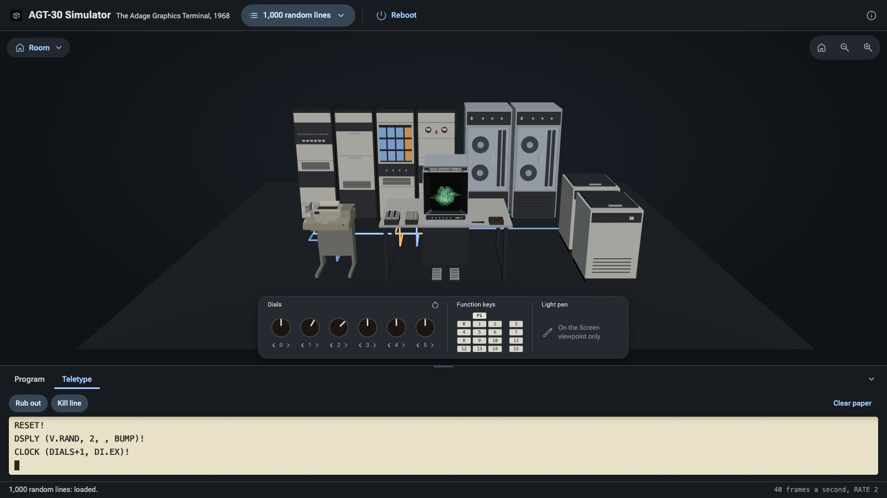
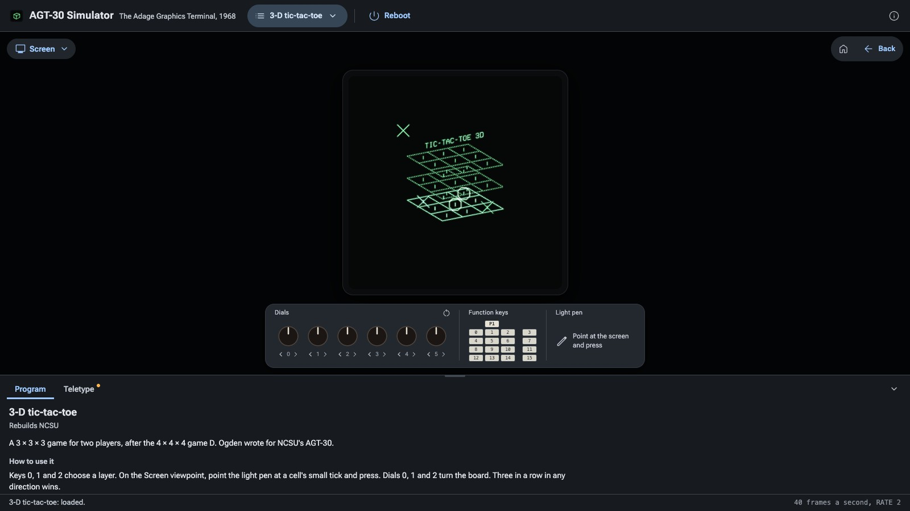
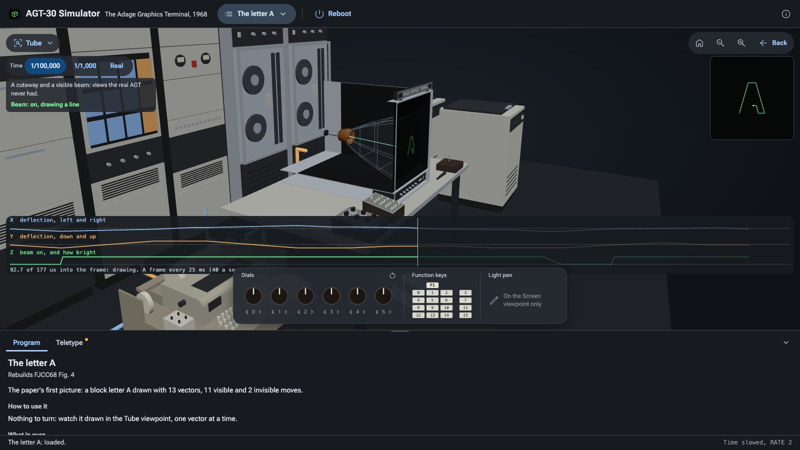

# AGT-30 Simulator

[](https://github.com/wixette/agt30-simulator/actions/workflows/test.yml)

The Adage Graphics Terminal, model 30 (1968), in your browser: a 30-bit processor that walked a structured picture every frame, a hybrid analog array that turned it in three dimensions in under 4 microseconds a point, and a refreshed vector CRT, with its console and its Teletype.

> **An early pre-release (v0.0.1).** The simulator is small and still changing. Its links (`#view=…&program=…`) may change before 1.0.0, and where the documents stop it reconstructs, as listed below. A full README, with a guide to using it, comes with 1.0.0.

**[▶ Try it online](https://wixette.github.io/agt30-simulator/)**: nothing to install. Made for a desktop browser: recent Chrome, Edge, Safari or Firefox.



<table>
<tr>
<td width="50%"><b>The Screen</b>: the picture close up, here 3-D tic-tac-toe in play, the marks placed with the light pen.<br></td>
<td width="50%"><b>The Tube</b>: the scope cut open, time slowed 100,000 times, the beam drawing the letter A, with its X, Y and Z signals below.<br></td>
</tr>
</table>

## What is in it

- **The installation in 3D:** the operator's desk with the 21-inch scope and the console's devices, the ASR-33 Teletype, four racks, two tape drives and two disk drives, and the cables between them. Click a part for its card.
- **Four viewpoints:** the Room; the Console, from the operator's seat; the Screen, the picture close up, where the light pen works; and the Tube, the scope cut open, with the beam drawing in time slowed 100,000 times, and its X, Y and Z signals traced.
- **Seven programs**, from the Programs menu, each typed on the Teletype as an operator would have typed it:
  - the letter A, the 1968 paper's first picture;
  - a cube turned by the dials, and the same cube in perspective, computed by the processor;
  - the tunnel, with and without depth cueing;
  - a town built from one house;
  - 3-D tic-tac-toe, played with the light pen;
  - 1,000 random lines, the paper's measure of the array, which you can push until the picture no longer fits a frame.
- **The console:** six dials, sixteen function keys and PULSE 1, and the light pen.
- **The Teletype and the AMOS monitor:** type statements yourself, such as `DSPLY (V.CUBE, 2)!`.

## Run it on your own machine

There is nothing to build. Serve the repository's folder over HTTP:

```
git clone https://github.com/wixette/agt30-simulator.git
cd agt30-simulator
python3 -m http.server 8000
```

Then open <http://localhost:8000/>. (Opening `index.html` from disk does not work: browsers do not load its modules from `file://`.)

## What is reconstructed

Some of the hardware is documented only in part, and v0.0.1 was built before we knew of any of the AGT's software in public. M. Howard's images of NCSU's tapes, published in 2025 with real ADEPT source and binaries, have since come to our attention ([research/ncsu-tapes.md](research/ncsu-tapes.md)); the simulator does not use them yet. Where the documents stop, the simulator chooses. Each choice is listed here; [design/reconstructions.md](design/reconstructions.md) gives the sources, the reasons, and what would settle each.

- **R1.** The DPR-2's instruction encodings: the mnemonics and times are documented, the bit layout is ours.
- **R2.** DSPLY is JavaScript, charged at the documented processor time; some of its times are estimates.
- **R3.** Three gaps in the image format are filled our way.
- **R4.** The programs are ours, written before we knew of the NCSU tapes.
- **R5.** The array's analog drift is modelled but off.
- **R6.** The multiply unit's product is the integer product of two 15-bit numbers.
- **R7.** A dial is read by comparing it with the array's X register.
- **R8.** The assembler is a subset of ADEPT, with our syntax for display items' arguments.
- **R9.** What the monitor types back is ours: echoes, results and ?.
- **R10.** Interrupts: the pen, the Teletype and the frame clock are served directly.
- **R11.** The pen-hit table's layout and PENHT's code are ours.
- **R12.** Dash mode draws about ten dashes an inch.
- **R13.** The tunnel's perspective routine is JavaScript, charged an estimated time.
- **R14.** The phosphor: green and medium-short, P31-like; the GDS1's is not documented.
- **R15.** Core at start holds the paper's pictures and the resident routines; 32K words, as NCSU's.
- **R16.** Sizes: the scope measured from photographs; the racks, tapes and disks estimated.
- **R17.** The Teletype's shape: proportions measured from a reference model, scaled to its documented size.
- **R18.** The console's devices: shapes from photographs; the pedals as the period's foot switches.
- **R19.** The cables are a diagram of the signal paths, not the real cabling.
- **R20.** The cutaway and the visible beam are views the real AGT never had.

## Sources and credits

The simulator rests on T. G. Hagan, R. J. Nixon and L. J. Schaefer's paper "The Adage graphics terminal" (AFIPS Fall Joint Computer Conference, 1968); Adage's manuals and brochures, kept by [bitsavers.org](http://www.bitsavers.org/pdf/adage/agt/); N. England's [history of the NCSU graphics lab](https://www.graphics-history.org/ncsu/index.htm); and M. Howard's recollections and [the NCSU tapes he recovered](https://github.com/cramcram/AGT-30). Every source is listed in [research/bibliography.md](research/bibliography.md).

It is built with [three.js](https://threejs.org/), [Roboto Flex](https://github.com/googlefonts/roboto-flex) and [Material Symbols](https://github.com/google/material-design-icons).

## Licence

The code is under the [Apache License 2.0](LICENSE); the documents, data and pictures of our own under [CC BY-SA 4.0](LICENSES/CC-BY-SA-4.0.txt). three.js is MIT, Roboto Flex is under the SIL Open Font License 1.1, and Material Symbols is Apache-2.0. Each file's licence is declared by [REUSE](https://reuse.software); see [docs/licensing.md](docs/licensing.md).
