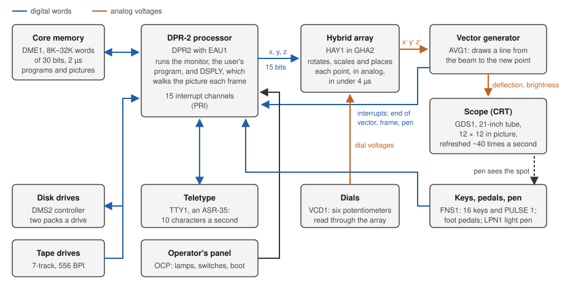
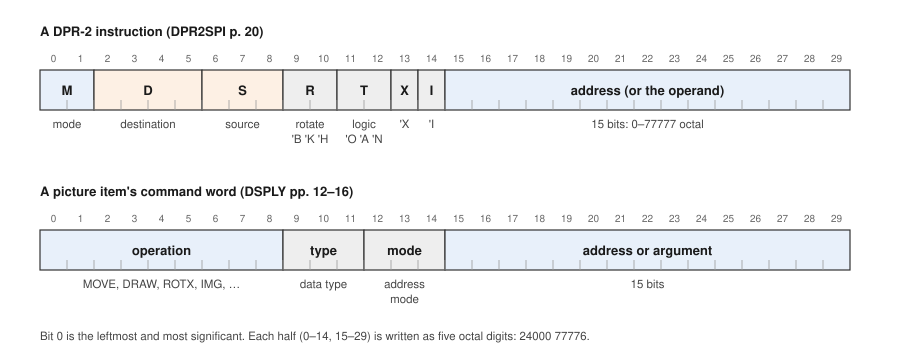
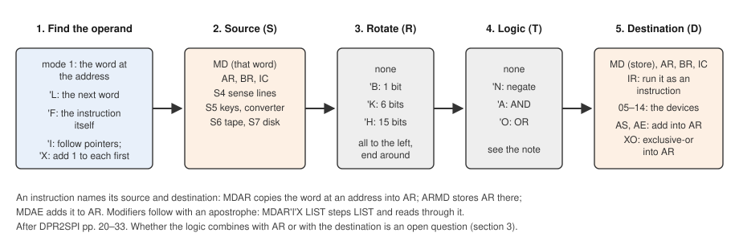
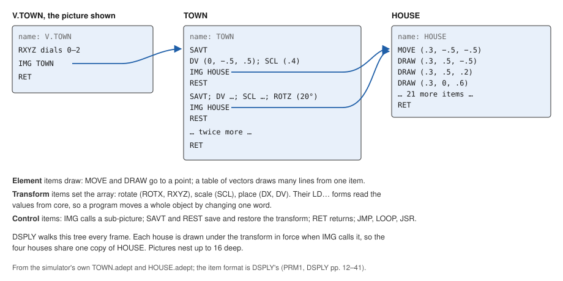
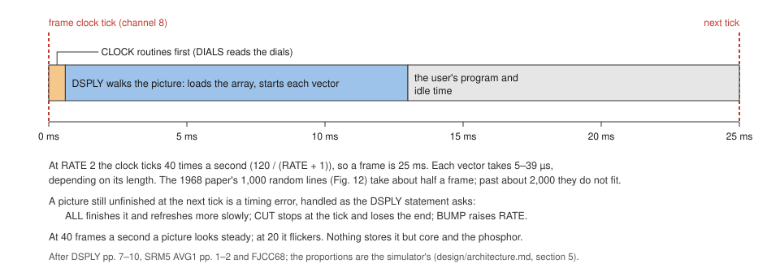
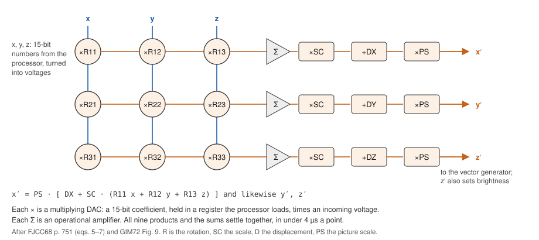
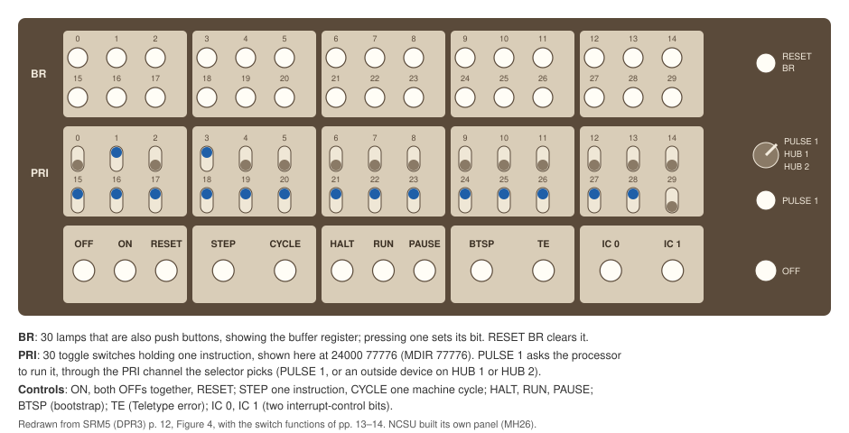
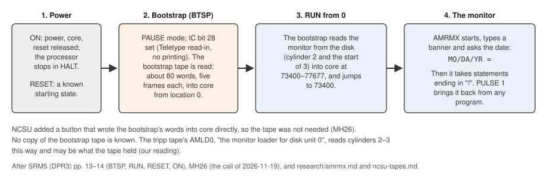
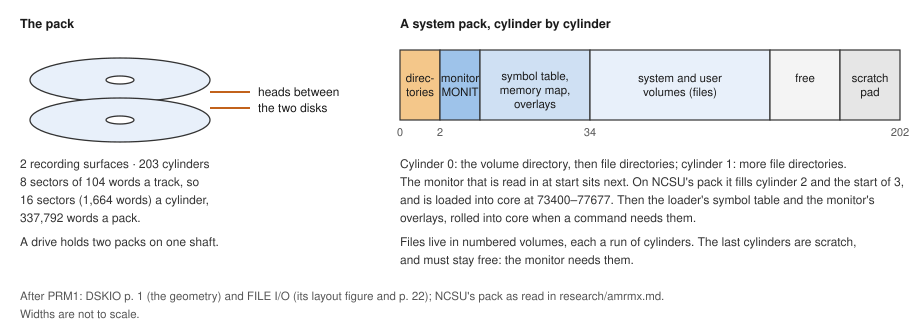

# The AGT-30 for today's engineers

An overview of the Adage Graphics Terminal, model 30, for someone who knows today's computers and not this one. It explains what each part of the machine did and how the parts worked together. It gives enough detail to read the manuals, follow the simulator's code, and talk with the people who used the machine.

**How to read it.** The sections build on each other, but each can be read alone; the glossary at the end explains every Adage name in a line. Numbers are octal unless they say otherwise, as on the machine: 77776 is octal, 32,768 is decimal. Bit 0 is a word's leftmost bit. Sources are cited by key, such as DPR2SPI p. 20; Appendix C says what each key is. Where the documents stop and the simulator has to choose, the text says so and gives the entry in [../design/reconstructions.md](../design/reconstructions.md), such as R7.

**Status:** draft, 2026-11-23, for review by M. Howard.

## Contents

1. [The machine at a glance](#1-the-machine-at-a-glance)
2. [Words and numbers](#2-words-and-numbers)
3. [The DPR-2 processor](#3-the-dpr-2-processor)
4. [Interrupts](#4-interrupts)
5. [The picture](#5-the-picture)
6. [Input devices](#6-input-devices)
7. [The operator's panel, and starting the machine](#7-the-operators-panel-and-starting-the-machine)
8. [Disks and tapes](#8-disks-and-tapes)
9. [The software](#9-the-software)
10. [What is known, and what is not](#10-what-is-known-and-what-is-not)
11. [Glossary](#11-glossary)

Appendices: [A. The instructions](#appendix-a-the-instructions) · [B. Statements and picture items](#appendix-b-statements-and-picture-items) · [C. The sources](#appendix-c-the-sources)

## 1. The machine at a glance

Adage, Inc., of Boston introduced the AGT in 1968 to draw three-dimensional line pictures and turn them in real time, under the hands of the person at the console. The 1968 paper that introduced it (FJCC68) shows a cube turned by dials, a letter A drawn vector by vector, and a thousand random lines turning smoothly. In 1968 that took a room of equipment; today a phone does it. The AGT-30 is one of three models, the 10, 30 and 50 (BRO69); in the AGT-50 a display controller of its own takes over from the processor (SRM5 AVG1). The Model 5, whose reference manual (SRM5) we often cite, was in M. Howard's view a stripped-down AGT sold as the display for a larger computer (MH26).

The simulator models the AGT-30 of North Carolina State University's graphics lab in the 1970s, the one whose tapes survive (NCSU; MH25).



*Figure 1. The units of an AGT-30 and the signals between them. Blue lines carry digital words, orange lines analog voltages.*

The design rests on one division of labour:

- **The processor walks the picture.** A picture lives in core memory as a structured list (section 5). Forty times a second a program called DSPLY reads it from the top and sends the coordinates of every point to the array.
- **The array does the arithmetic, in analog.** The hybrid array multiplies each point by a 3 × 3 rotation, scales it and moves it, with amplifiers and multiplying converters, in under 4 µs a point. It takes one point at a time: there is one array, and the points come to it one after another as DSPLY sends them. What happens at once is the arithmetic for that point, all nine products and three sums together (section 5). The array's exact size is not documented; it was one unit among the racks, where a digital multiplier as fast would, in M. Howard's estimate, have filled a rack by itself (MH26).
- **The vector generator draws.** It takes each transformed point and moves the CRT's beam to it in a straight line, bright for a line and dark for a move.
- **Nothing stores the picture but core and the phosphor.** There is no frame buffer. A line glows only for a moment after the beam passes, so the whole picture is drawn again every frame. A picture with too many lines no longer fits in a frame and flickers.

**The installation** filled a room: four racks, two 7-track tape drives, two disk drives, a Teletype, and the console desk with the scope, the dials, the function keys, the light pen and foot pedals (NCSU). At NCSU it shared the room with a Varian 620 minicomputer, an Ambilog 200 (Adage's earlier hybrid computer), a drum plotter and a color raster display of the lab's own making.

Adage named every unit with letters and a number, and the documents use these names constantly:

| Unit | What it is |
|---|---|
| DPR2 | the processor, with DME1 (core memory) and EAU1 (the arithmetic unit). SRM5 describes the Model 5's DPR3, which is close to it |
| GHA2 | the hybrid array (HAY1), its input selector (GDD1) and its converter (ADC5) |
| AVG1 | the vector generator |
| GDS1 | the scope: a 21-inch CRT showing a 12 × 12-inch picture |
| VCD1, FNS1, LPN1 | the dials, the function keys, the light pen |
| TTY1 | the Teletype |
| OCP | the operator's control panel |
| DMS2, MTP | the disk controller, the tape controllers |
| PRI | the priority interrupt system |

## 2. Words and numbers

**A word is 30 bits.** It is usually read as two 15-bit halves, each written as five octal digits: `24000 77776` is one word. An address is 15 bits, so the processor can address 32,768 words (77777 is the last). A standard AGT-30 had 8,192 words of core; NCSU's was rebuilt with 32,768 (NCSU; MH26). Core memory keeps its contents with the power off, and a memory cycle takes 2 µs.

**Negative numbers are one's complement.** To negate a number, invert every bit. So there are two zeros: +0, all zeros, and −0, all ones (77777 in a half). Adding is end-around: a carry out of the top bit is added back at the bottom. This catches programmers: 1 − 1 gives −0, and a test for "not zero" that looks at the bits sees −0 as non-zero. Our programs count up and compare, rather than count down to zero, for this reason (DPR2SPI p. 37; [../research/dpr2-manual.md](../research/dpr2-manual.md)).

**Most numbers are fractions.** The processor's arithmetic and the array treat a 15-bit half as a fraction between −1 and +1: the leftmost bit is the sign and the binary point follows it. So 20000 is +0.5, 37777 is just under +1, and 40000, the one's complement of 37777, is −0.99997 (DPR2SPI p. 9). A coordinate on the screen is such a fraction of full scale, and so is every coefficient in the array. Since a half holds one fraction, a word holds two, and that is how points are usually stored: a picture item keeps its first argument in its command word's lower half and the next two as the halves of the following word, so MOVE (z, x, y) takes two words (DSPLY p. 13). Destination 05 takes a point's x and y the same way, one in each half.

**Characters are 6 bits,** five to a word. AMOS, Adage's operating system, has its own 64-character code: upper case, digits and punctuation, as the Teletype prints them. Code 00 prints `[` and starts a comment in source text; a line ends with code 15 ([../research/ncsu-tapes.md](../research/ncsu-tapes.md)).

**The top of core is special.** The words from about 77700 up hold the pivots: the addresses where each interrupt finds its handler (section 4). The monitor sits below them, from 73400 (section 9).

## 3. The DPR-2 processor

The DPR-2 is a 30-bit processor with a 2 µs memory cycle; an addition takes 4 µs, a multiplication 4–10 µs (SRM5 DPR3; FJCC68 p. 748). Everything below is from its manual, *Digital Processor, DPR2: Subsystem Programming Instructions* (DPR2SPI), which settles what the older documents leave open.

### Registers, and one bus

The processor has a handful of registers, and every ordinary instruction moves a word from one of them to another along a single transfer bus:

| Register | What it holds |
|---|---|
| LC | the location counter: the address of the next instruction (today's program counter) |
| IR | the instruction register: the instruction being executed |
| MD | the memory data register: the word read from, or written to, core |
| AR | the accumulator, in the arithmetic unit (EAU1): where sums and products end up |
| BR | the buffer register: a general register, shown in lamps on the panel |
| IC | the interrupt control register: which devices may interrupt (section 4) |
| S4 | the sense lines: 30 status bits from the devices, such as "disk ready" and "Teletype has a character" |
| S5, S6, S7 | device inputs: the function keys and the converter (S5), tape data (S6), disk data (S7) |

There is no stack, no general register file, no flags register in today's sense. Instead, a source and a destination are named in every instruction, and the devices are sources and destinations like any register. Writing a word to destination 05 sends x and y to the array; reading source S7 takes a word from the disk ([../research/dpr2-block-diagram.md](../research/dpr2-block-diagram.md)).

### The instruction word



*Figure 2. Above, a DPR-2 instruction; below, for comparison, the first word of a picture item (section 5).*

An instruction is one word (DPR2SPI p. 20):

- **M, the mode** (bits 0–1): 0 for a special instruction (a jump, a skip, a device command); 1, 2 and 3 for a transfer, which differ in where the operand comes from.
- **D and S, the destination and source** (bits 2–5 and 6–8). D has four bits and S only three because there are more places to send a word than to take one from: sixteen destinations (the registers, the devices, and three that compute) against eight sources.
- **R, the rotation** (bits 9–10) and **T, the logic** (bits 11–12), applied to the word on its way.
- **X and I** (bits 13, 14): index and indirect.
- **The address** (bits 15–29).

ADEPT, the assembler (section 9), writes a transfer as its source then its destination, with modifiers after apostrophes. Appendix A lists every source, destination and instruction.

| ADEPT | What it does |
|---|---|
| `MDAR X` | load AR from the word at X |
| `ARMD X` | store AR into X |
| `MDAE X` | add the word at X to AR (destination AE) |
| `MDAR'L` | load AR from the next word in the program, a constant |
| `MDBR'F 5` | load BR with the instruction itself: its address half is 5 |
| `MDAR'I P` | load AR from the word whose address is in P |
| `MDAR'I'X P` | add 1 to P, then do the same: step through a list |
| `S5AR'H` | read S5 with its halves swapped |
| `ARIR'F` | execute the word in AR as an instruction |



*Figure 3. A transfer instruction, step by step.*

**Finding the operand.** In mode 1 the operand is the word at the address. In mode 2, written `'L`, it is the word after the instruction, which makes constants easy. In mode 3, written `'F` (fast), there is no memory cycle and the operand is the instruction itself, upper half and all, so an instruction can carry a small number in its address field (DPR2SPI pp. 19, 30).

**Indirection** (`'I`) treats the word at the address as a pointer: each word with its own indirect bit set points on to the next, for as many levels as the chain has. A chain that loops never ends, and HALT cannot stop it; only turning the power off does, because the flow of control in the manual has no exit from it (DPR2SPI p. 15; MH26). **Indexing** (`'X`) adds 1 to each word of the chain before it is read, so `'I'X` steps a pointer through an array, one element per instruction (DPR2SPI pp. 32–33).

**Rotation and logic.** On its way the word can be rotated left, end around, by 1 bit (`'B`), a 6-bit character (`'K`) or a 15-bit half (`'H`, which swaps the halves). It can then be negated (`'N`), or ANDed (`'A`) or ORed (`'O`) as it goes into the destination. The manual and M. Howard describe the logic slightly differently, whether it combines with AR or with the destination itself, and the question is open (section 10).

**Destinations that compute.** Three destinations do arithmetic into AR: AS adds the operand's lower half, with its sign extended, to the whole of AR; AE adds all 30 bits; XO exclusive-ors them. AS was used above all to modify instructions, for example to relocate an address by adding an offset (MH26). Writing to IR executes the word as an instruction, which the monitor uses to return from subroutines (see JPSR, below).

### Special instructions

Mode 0 holds the instructions that are not transfers (DPR2SPI pp. 35–46):

- **JUMP** goes to the address. **JPSR**, jump to subroutine, writes the return address into the address half of the word at the address, leaving its upper half as it was (normally a JUMP), and continues at the next word. So a subroutine's first word is a jump back, and `MDIR` of that word, or `JUMP'I` through it, returns.
- **JPAN, JSAN, JPLS, JSLS** are JUMP and JPSR made conditional: on AN, "AR negative" (bit 0 set), or on LS, "lower significance" (AR's lower half is not +0; note that −0 counts as non-zero).
- **ANDD and LSDD** are conditional transfers under the same two conditions: `ANIR X` executes the word at X only if AR is negative. **SKUA and SKLA** skip the next instruction if chosen sense lines are set.
- **The EAU's operations**: multiplication and division of 15-bit fractions (MPY, DIV in three forms), shifts (ARRS, ARLS), normalization (NORM).
- **Device commands**: OPTY sends a bit to the Teletype (section 6); CNVT starts the converter; OPCR strobes the card reader; OPIO and OPTI drive other devices.
- **Interrupt control**: FPRI freezes interrupts and UPRI releases them; PINT asks for the lowest-priority interrupt (section 4).

### A subroutine, line by line

The simulator's routine RVCD reads a dial (section 6). It is ours, written the way the NCSU sources write, and it shows most of the above at work:

```
RVCD:   0               [ JPSR RVCD leaves the return address here
        MDAR'I RVCD     [ the argument (the word after the call): a dial
        ARMX            [ to destination 07: select it, start converting
        S5AR'H          [ the result, S5's lower half, into AR's upper
        ARRS 17         [ shift right 15 (17 octal), keeping the sign
        JUMP'I'X RVCD   [ step past the argument, and return
```

A program calls it with `JPSR RVCD` followed by a word holding the dial's number, and gets the dial's setting in AR as a fraction.

## 4. Interrupts

Devices get the processor's attention through the **priority interrupt** system, PRI. The AGT-30 has fifteen channels, numbered 0 to 14; channel 0 is served first and 14 last (DPR2BD; MHN):

| Channel | Device | Channel | Device |
|---|---|---|---|
| 0 | EAU1, the arithmetic unit | 8 | the frame clock, from AVG1 |
| 1 | PULSE 1 | 9 | HWD1, the hardware window |
| 2 | the tapes | 10 | the light pen |
| 3 | the disk | 11 | the vector generator |
| 4 | communications | 12 | the character generator |
| 5 | the Teletype | 13 | the paper tape |
| 6 | the keyboards | 14 | PINT, the program interrupt |
| 7 | the card reader | | |

**How a channel is served.** A device does not supply an address to jump to; it supplies an *instruction*, its priority instruction word. Between two instructions, if a channel is waiting and interrupts are not frozen, the processor executes that word in place of the next instruction from memory, without advancing LC (SRM5 DPR3 pp. 7–9). The word is usually `JPSR'I` through a **pivot**, a fixed word near the top of core that holds the address of the device's handler. JPSR stores where the program was, so the handler returns there when it is done. Changing a pivot changes the handler; the monitor does so to switch a device between programs.

The pivots the NCSU software uses ([../research/ncsu-tapes.md](../research/ncsu-tapes.md), [../research/amrmx.md](../research/amrmx.md)):

| Pivot | For |
|---|---|
| 77720–77726 | the disk |
| 77755 | the frame clock |
| 77756, 77757 | end of vector, end of the display list |
| 77760 | the light pen |
| 77771 | AR overflow |
| 77776 | PULSE 1 |

**The hardware window** (HWD1, an option) is clipping in hardware. The program sets six limits, the lowest and highest x, y and z, which define a box. Whenever the beam is driven outside the box, HWD1 blanks it, sets a bit telling which limit was crossed (sense lines S4[11, 12, 25–28]), and can interrupt on channel 9 (SRM5 HWD1; DPR2BD).

IC enables and disables devices bit by bit, and FPRI and UPRI freeze and release the whole system, for code that must not be interrupted.

**PULSE 1** is the operator's Ctrl-C: it aborts whatever is running and returns to the monitor. The button is on the operator's panel and beside the function keys. Its channel does not take its instruction from a device but from 30 switches on the panel (section 7), and they are normally set to `24000 77776`. That decodes as `MDIR 77776`: execute the word at the PULSE 1 pivot, which leads back to the monitor. M. Howard remembers the switches staying at that setting "99.9 % of the time"; they were changed only to debug a broken machine, for example to move BR to AR by hand (MH26).

**PINT** is the lowest-priority channel, raised by the program itself. A routine at a high priority, such as the frame clock's, can do its urgent work and leave the rest to a PINT, which runs only when nothing more urgent waits, and then returns to the main-line program (DPR2SPI p. 40; MH26). DSPLY does exactly this: the CLOCK routines run at the PINT level, in the gaps while the vector generator draws (DSPLY p. 10; section 5).

Like any channel, PINT is served by an instruction, `JPSR'I PIPVT`: "jump to the routine whose address is in the word PIPVT". PIPVT is that word, a pivot like the others, and whoever wants PINT's work done puts the routine's address there. Where in core PIPVT is, the documents we have do not say. The simulator had to put it somewhere, and chose 77770, beside the other pivots; that choice is ours (R10).

## 5. The picture

### Structured images

A picture is not a list of pixels or even of lines. It is a program-like structure of **items** in core, which DSPLY, the display operator, interprets (PRM1, DSPLY pp. 12–41). Every item begins with a command word (Figure 2, in section 3): an operation in bits 0–8, a data type, an address mode, and an address or argument. An image starts with a two-word name and ends with RET.



*Figure 4. A structured picture, from the simulator's TOWN and HOUSE programs.*

There are four kinds of item:

- **Element items** draw. MOVE and DRAW go to a point (z, x, y), dark or bright. Table items draw many vectors from one item: a list of 2D or 3D points, or increments.
- **Transform items** load the array: rotations about an axis (ROTX, ROTY, ROTZ) or all three (RXYZ), a scale (SCL), a displacement (DX, DY, DZ, DV). Each has an LD… form that takes its value from a word in core, so a program turns an object by changing one word, and the next frame shows it.
- **Control items** structure the picture. IMG calls a sub-image, as a subroutine; SAVT and REST save and restore the transform around it; LOOP, JMP and RET do what they say; JSR calls DPR-2 code in the middle of a picture.
- **View items** set the window and the depth cue (DEPTH, LDW, LWS).

Because a sub-image is drawn under the transform in force when it is called, one copy of a house can appear four times, at four places and sizes. The 1968 paper calls these **structured images** (FJCC68 p. 749). Images nest up to 16 deep.

### DSPLY and the frame

DSPLY is a DPR-2 program. Each frame it walks the image from the top, loads the array's registers as transforms come, and for each point writes x and y to destination 05 and z to destination 06, as we read the block diagram; the array transforms the point and the vector generator draws to it. The vector generator interrupts when a vector is done, and DSPLY sends the next (SRM5 p. 2; [../research/amrmx.md](../research/amrmx.md)).

The operator starts a picture from the monitor: `DSPLY (V.CUBE, 2)!` shows the image V.CUBE at RATE 2. The frame clock ticks 120 / (RATE + 1) times a second: 60, 40, 30, 24 or 20 frames for RATE 1 to 5 (DSPLY pp. 7–10). At each tick DSPLY starts the picture again from the top, and the CLOCK routines are run once. They are small user routines chained to the frame, such as DIALS, which reads the dials into words that the picture's LD… items use. They run at the PINT level, below DSPLY and the vector generator, so they use the moments while vectors are being drawn and do not delay the picture (DSPLY p. 10). What is left of the frame goes to the user's program. Appendix B lists DSPLY's statements.



*Figure 5. One frame at RATE 2, 40 frames a second.*

A frame not finished at the next tick is a timing error, and the DSPLY statement chooses what happens: ALL finishes the picture and refreshes more slowly, CUT drops the rest, BUMP raises RATE until it fits and says so on the Teletype (DSPLY p. 8).

No DSPLY code has been found, on the NCSU tapes or anywhere else. The simulator interprets the format in JavaScript, bit for bit as the manual defines it, and charges the documented processor time (R2, R3).

### The hybrid array



*Figure 6. The hybrid array.*

The array is the AGT's speed. For each point it computes

$$\begin{pmatrix} x' \\ y' \\ z' \end{pmatrix} = PS \left[ \begin{pmatrix} D_x \\ D_y \\ D_z \end{pmatrix} + SC \begin{pmatrix} R_{11} & R_{12} & R_{13} \\ R_{21} & R_{22} & R_{23} \\ R_{31} & R_{32} & R_{33} \end{pmatrix} \begin{pmatrix} x \\ y \\ z \end{pmatrix} \right]$$

that is, $\mathbf{p}' = PS\,(\mathbf{D} + SC\,R\,\mathbf{p})$: a rotation $R$, a scale $SC$, a displacement $\mathbf{D}$ and a picture scale $PS$ (FJCC68 p. 751). In today's terms it is an affine transform, $\mathbf{p}' = M\,(x, y, z, 1)^\mathsf{T}$ with the 3 × 4 matrix $M = PS\,[\,SC\,R \mid \mathbf{D}\,]$, which is what M. Howard calls a 4 × 3 matrix multiplier (MH26). There is no division, so no perspective (below). Each coefficient sits in a register as a 15-bit fraction, loaded by the processor. Each product is a **multiplying digital-to-analog converter**: a DAC whose reference input is the incoming voltage, so its output is the voltage times the digital coefficient. Each sum is an operational amplifier. The nine products and three sums settle together, to 0.01 % in about 2 µs (SRM5 GHA4); a whole transformation takes under 4 µs, overlapped with drawing the previous vector. The arrays of other models differ: the Model 5's only adds an offset to x and y (SRM5 GHA4).

Analog circuits drift. The array was recalibrated about once a year (CCT20); M. Howard spent a couple of weeks each summer at it, and could tell a particular converter was failing when the characters lost their italic slant (MH26). The simulator computes exactly and models drift, off by default (R5).

**Perspective** needs a division by depth, and the array only multiplies and adds. The 1968 paper has the processor compute the perspective factor for each point and scale it (FJCC68 p. 753), and the simulator's perspective cube does so. M. Howard remembers the array itself doing a perspective divide; whether a later array did is an open question (section 10).

**Depth cueing** is the array's other trick: z′ also sets the brightness, so lines further back are dimmer, by up to 10 : 1 (the VIEW statement's DIM, between FRONT and BACK; FJCC68 p. 753). It gives a second cue to depth, beside perspective.

The array also has analog inputs of its own: the dials, the joystick and the tablet are wired to it, and it is how the processor reads them (section 6).

### The vector generator and the scope

AVG1 takes each transformed point as a voltage and drives the beam from where it is to there in a straight line, at nearly constant speed, bright for a DRAW and blanked for a MOVE. A vector takes 5 to 39 µs, 3 µs of it between vectors, growing with its longest component; a long move takes 15 µs (SRM5 AVG1 pp. 1–2). The analog space is 20 inches square, but one stroke's component is at most 10 inches, and the GDS1 scope shows a 12 × 12-inch square; lines beyond it are clamped. A short mode draws tiny vectors faster, at the cost of accuracy.

The scope is a 21-inch CRT. Its phosphor is not documented (R14). M. Howard remembers it as P7 (or P30, as the recording of the call has it): a cool white flash that decays towards green, with a very long afterglow (MH26). A long afterglow helps a refreshed display flicker less, and smears a moving one. Text was hard to read beyond five or six lines at once, and the lab darkened the room to watch (MH26).

Characters are drawn as vectors too, a few strokes each, in italics (MH26).

## 6. Input devices

**The dials.** Six knobs, VCD1, each a potentiometer giving a voltage. NCSU built its own, with 15-turn potentiometers for fine control (MH26). They are wired to the array's analog inputs. To read one, a program writes the dial's number to destination 07 (GDD1), which selects the input and starts the converter, ADC5; the result appears in the lower half of S5 (DPR2SPI p. 41; DPR2BD). The routine in section 3 does exactly that. Which bits of the word written to 07 choose the input is not documented (R7).

**The function keys.** Sixteen push buttons, FNS1, each with a lamp the program can light, read through S5's upper half. Two foot pedals act as keys, so a user could step up and down a listing with the feet, and most AGTs had them (SRM5 FNS1; MH26). **PULSE 1** sits beside the keys (section 4).

**The light pen.** LPN1 is a photocell in a pen. Pointed at the screen, it sees the beam pass under it and interrupts on channel 10 at that moment. Since DSPLY knows which item it was drawing, it can record which part of the picture was picked, in a table of the last 16 hits (DSPLY p. 30). There is no position sensing in the pen itself: it knows *when*, and the display list says *what*.

**The Teletype.** The operator's terminal, a keyboard and a printer, 10 characters a second, upper case only. Adage supplied the heavy-duty **ASR-35** (SRM5 Figure 3; MH26), with a paper tape reader and punch. The processor talks to it a bit at a time: OPTY sends one bit from BR[22], and the input arrives on sense line S4[14], with interrupts on channel 5 (DPR2SPI p. 43). What timed the bits is not in the documents we have; the simulator types a whole character at once (R9).

NCSU also had a Rand tablet and a joystick, both read through the array's inputs like the dials (DPR2BD).

## 7. The operator's panel, and starting the machine

### The panel



*Figure 7. The operator's control panel, with its PRI switches at the PULSE 1 setting.*

The operator's control panel, OCP, is the processor's front panel (SRM5 DPR3 pp. 12–14):

- **BR**: 30 lamps showing the buffer register. Each lamp is also a push button. The button does not stay down: pressing it sets that bit of BR, and the bit stays set, lamp lit, until RESET BR clears the register or a program changes it. The lamps show the register, not the buttons.
- **PRI**: 30 toggle switches holding one instruction, run when PULSE 1 is pressed (or when an outside device asks, through HUB 1 or HUB 2, chosen by a rotary selector). PULSE 1's lamp stays lit while its request waits.
- **RUN** starts the processor from the instruction at LC. **HALT** stops it at the end of the current instruction. **STEP** executes one instruction, **CYCLE** one machine cycle, while halted. **PAUSE** lets only PRI instructions run.
- **RESET** puts the machine in a known state and halts it. **ON** powers it up; the two **OFF** buttons must be pressed together.
- **BTSP** enters or leaves bootstrap mode. **TE** lights when the Teletype interrupts twice before being served. **IC 0, IC 1** show and set two bits of IC.

**What the panel is for.** The manual sums it up: with the PRI switches, BR "may be used to display any machine source and to load words to any destination" (SRM5 DPR3 p. 13). Since the switches hold a whole instruction and PULSE 1 runs it, the operator can do by hand anything one instruction does. For example (our reading of the manual, not a documented procedure):

| To | Set the PRI switches to | Then |
|---|---|---|
| look at a word of core | `MDBR X` (BR from the word at X) | press PULSE 1; read BR's lamps |
| change a word of core | `BRMD X` (the word at X from BR) | set BR's bits; press PULSE 1 |
| look at AR | `ARBR` | press PULSE 1 |
| start a program at X | `JUMP X` | press PULSE 1 in PAUSE, then RUN |
| return to the monitor | `MDIR 77776` (the usual setting) | press PULSE 1 |

With HALT, STEP and CYCLE the operator can also walk a program one instruction or one machine cycle at a time.

Day to day, an operator used the Teletype and the monitor, and touched the panel to power on, boot, and press PULSE 1. It mattered most when the machine would not start, or was being repaired: M. Howard remembers the PRI switches changed only to debug broken hardware (MH26). NCSU built a panel of its own (MH26).

### Starting the machine



*Figure 8. Starting the machine.*

1. **ON** powers the processor, core and the rest, and the processor stops in HALT. Core still holds whatever was in it.
2. **BTSP** enters bootstrap mode: PAUSE, and IC bit 28 set, so the Teletype reads without printing, with the interrupts set up to read a bootstrap tape (SRM5 DPR3 p. 14). The bootstrap is a short paper tape: about 80 words, five rows of holes for each 30-bit word, read into core from location 0 (MH26).
3. **RUN** from 0. The bootstrap reads the monitor from the disk, cylinder 2 and the start of 3, into core at 73400–77677, and jumps to 73400, as AMLD0 does ([../research/amrmx.md](../research/amrmx.md)).
4. **The monitor** runs, types its banner and asks the date: `MO/DA/YR = `. From then on it takes statements on the Teletype.

**Why both a tape and a disk?** Because each does what the other cannot. Core starts with nothing useful in it (or something left over), and the processor can only run what is in core. The hardware alone can read one thing without a program: characters arriving from the Teletype, which BTSP mode stores. The disk needs a program to drive it: one that seeks a cylinder, starts a transfer, and takes each word as it arrives. So a short program comes in first by the one path the hardware knows, and that program reads the large one from the disk. Reading the whole monitor from paper tape would also have been slow: some 4,000 words, five tape frames each, at ten frames a second, is over half an hour, against well under a second from the disk. Early machines commonly started in two such stages; and since core keeps its contents with the power off, the bootstrap often stayed in core from one start to the next.

NCSU added a button that wrote the bootstrap's 80 words into core from read-only memory, which saved reading the tape every time (MH26). No copy of the tape is known. The tripp tape holds AMLD0, "the monitor loader for disk unit 0", which reads the monitor exactly this way and may be what the tape held (our reading).

## 8. Disks and tapes

### The disk

The AGT-30 used removable **disk packs**. A drive held two packs on one shaft, one on each side of the cabinet, and both had to be mounted to run; M. Howard believes the drive was ICT's "twin disk" (MH26). A pack had two oxide-coated disks with the heads between them, so two recording surfaces. The heads were moved by a motor and locked onto a track by a toothed cam and a solenoid: a seek was loud, and the operators knew from the rhythm of the seeks how far a compilation had got (MH26).



*Figure 9. A disk pack, and the layout of a system pack.*

The DMS2 controller drives up to four drives. A track has 8 sectors of 104 words; a cylinder, the same track on both surfaces, has 16; a pack has 203 cylinders, 337,792 words (PRM1, DSKIO p. 1). The processor reads disk words through source S7 and writes them through destination 14, a word at a time, with interrupts on channel 3.

**A system pack** (PRM1, FILE I/O) holds the volume directory and the file directories in cylinders 0–1, then the monitor read at start, then the loader's symbol table and the monitor's overlays, then the volumes in which files live, and at the end scratch cylinders the monitor needs. M. Howard's dump of his own system pack is the main source of what we know about the monitor (MH25).

### The tapes

The two tape drives took 7-track tape at 556 bits an inch: each frame of tape holds six data bits and a parity bit, so five frames make a 30-bit word. Programs and data were kept and exchanged on tape. A tape record starts with four words giving its file's name, date, type and length, and ends with a checksum. The file types say what a file holds ([../research/ncsu-tapes.md](../research/ncsu-tapes.md)):

| Type | Holds |
|---|---|
| ATEXT | source text, in AMOS's 6-bit code |
| RELOC | relocatable binary, as ADEPT produces it |
| RLSYM | a relocatable binary's symbols |
| DUMP | a core image, ready to run |
| BIN, DATA, MACRO, … | others |

The surviving tapes were read in 2022 at the Computer History Museum, on a streaming drive fitted with a 7-track head, with the signals captured by a logic analyser and decoded by L. Shustek's readtape (MH25; RT).

## 9. The software

### The monitor: AMOS and AMRMX

**AMOS** is the AGT's operating system: everything together, the monitor, the loader, the disk and file routines, the device handlers. **AMRMX**, the AMOS Resident Monitor (AMRMX71), is the part of it always in core, from 73400 up. In today's terms AMRMX is a small kernel and its command shell in one, much like the resident part of an early single-user system such as MS-DOS. A "resident monitor" in the 1960s sense is the supervisor that stays in core between programs: it loads and starts them and takes control back when they end. It is not a "system monitor" in the later sense of a debugger in ROM. It runs one job at a time. Its commands and device handlers are **overlays**, read from the disk into a fixed area when needed, which is how a large monitor fits in a small core ([../research/amrmx.md](../research/amrmx.md)).

The operator types **statements** on the Teletype, each ending with `!`, much as one types commands in a shell today:

| Statement | Does |
|---|---|
| `DSPLY (V.CUBE, 2)!` | show the image V.CUBE at RATE 2 |
| `HALT!` | stop the display |
| `CLOCK (DIALS+1, DI.EX)!` | chain a routine to the frame clock |
| `ADEPT ("CUBE")!` | assemble the source file CUBE |
| `OPEN (X)!`, `LIST (, A, B)!` | show and change words of core |
| `V!` | type the monitor's version |

The monitor answers `?` to a statement it cannot do and `*` to an argument it cannot evaluate (AMRMX71). The simulator implements a subset of these statements in JavaScript, since AMRMX's source is lost; the binary on M. Howard's pack is the aim of running the real one (R9).

### ADEPT, the assembler

ADEPT, the Adage Extendable Program Translator, is a macro assembler. Section 3 shows its syntax: a label ends with a colon, a comment starts with `[`, modifiers follow an apostrophe, and numbers are octal unless they end with a point. It has macros, repeats and conditional assembly, and produces relocatable binary for the loader. It is called **extendable** for a reason: it starts up holding its own symbol table, so a program can add to or change the assembler itself. That is why NCSU's sources begin with **EXPUNGE**, which clears ADEPT's internal symbols before the program's own; M. Howard once used the feature to make ADEPT assemble for a TMS9900 microprocessor (MH26; ADEPT71). ADEPT is Adage's own, for its own processors, and ran on the AGT itself; no version on another make of computer is known. With M. Howard's change it stayed on the AGT and produced code for another machine, a cross-assembler.

### Other software

- **FORTRAN IV**, the standard language of the time, which ran on most computers; Adage wrote its own compiler for it, which ran on the AGT and produced DPR-2 code. Adage's "Extended FORTRAN IV" added assembly code line by line in the middle of FORTRAN, and came with the usual mathematical libraries (MH25; MH26). A program in plain FORTRAN IV could move between machines; one using the extensions or the AGT's display could not.
- **EDIT**, a text editor on the scope, stepped up and down a file with the foot pedals.
- **Games** on M. Howard's pack: LIFE (Conway's, drawn with small squares), QUBIC (4 × 4 × 4 tic-tac-toe, by D. Ogden), BROSE (a spirograph), Space War, a lunar lander and an unfinished Pong (MH25; MH26).
- **Programs by the lab** for its plotter, its raster display and research.

The simulator's own programs, in `programs/`, were written before the NCSU tapes came to light, in the manuals' style (R4).

## 10. What is known, and what is not

**Settled by the documents and the tapes:** the instruction set and its encodings (R1); the arithmetic unit (R6); the interrupt channels and the pivots the software uses; the picture format, item by item; the array's equation; the vector generator's timing; the panel; the disk's geometry and a system pack's layout; the tape formats; the monitor's statements and messages.

**Reconstructed by the simulator,** where nothing survives to say otherwise (each entry in [../design/reconstructions.md](../design/reconstructions.md)):

| What | Why it is ours | Entry |
|---|---|---|
| DSPLY's code | no listing found; the format is interpreted in JavaScript, at the documented times | R2, R3 |
| How a dial's input is chosen | GDD1's word is undocumented | R7 |
| The Teletype's bit timing | the manual it refers to is missing | R9 |
| How the simulator serves some interrupts, and PIPVT | not yet modeled; the address is undocumented | R10 |
| The phosphor | undocumented; M. Howard's memory now gives a lead | R14 |
| The monitor | AMRMX's source is lost; a subset is written in JavaScript | R9, R15 |
| The installation's sizes and shapes | photographs and the period's common sizes | R16–R18 |

**Open questions** (and asked of M. Howard where marked; [../research/correspondence.md](../research/correspondence.md)):

- the phosphor's color and afterglow (asked);
- what timed the Teletype's bits (asked);
- what destination 07 takes in its word (asked), and what destinations 05 and 06 carry besides x, y and z;
- where PIPVT is (asked);
- whether `'A` and `'O` combine with AR or with the destination;
- whether any array did a perspective divide in hardware;
- how sixteen function keys fit S5's 15 bits;
- why the dump of M. Howard's pack holds about 61 cylinders' worth of words while its directory places volumes as far as cylinder 179.

## 11. Glossary

Adage's names for units, registers and ideas. The instructions and their modifiers are in Appendix A; the monitor's statements and the picture items in Appendix B.

| Term | Meaning |
|---|---|
| ADC5 | the analog-to-digital converter, read on S5 |
| ADEPT | the macro assembler |
| AMLD0 | the monitor loader for disk unit 0, on the tripp tape |
| AMOS | Adage's operating system |
| AMRMX | AMOS's resident monitor |
| AR | the accumulator |
| ATEXT, RELOC, DUMP | file types: source, relocatable binary, core image |
| AVG1 | the vector generator |
| BR | the buffer register, shown on the panel |
| BTSP | bootstrap: the panel button that reads the bootstrap tape |
| CLOCK | a routine chained to the frame clock, or the statement that chains it |
| core | magnetic core memory |
| cylinder | the same track on both surfaces of a disk pack |
| DME1 | core memory |
| DMS2 | the disk controller |
| DPR2, DPR-2 | the processor |
| DSPLY | the display operator, the program that draws an image every frame |
| EAU1 | the extended arithmetic unit, holding AR |
| EXPUNGE | ADEPT's statement that clears its internal symbols |
| FNS1 | the function keys and their lamps |
| frame clock | the interrupt that starts each frame, 120 / (RATE + 1) a second |
| GDD1 | the array's input selector, destination 07 |
| GDS1 | the scope |
| GHA2 | the hybrid array unit: HAY1, GDD1 and ADC5 |
| HAY1 | the hybrid array itself |
| HUB 1, HUB 2 | inputs on the panel through which outside devices can trigger the PRI switches |
| IC | the interrupt control register |
| image, item | a picture, and one entry of it |
| IR | the instruction register; as a destination, it executes the word |
| LC | the location counter |
| LPN1 | the light pen |
| MD | the memory data register |
| MDAC | a multiplying digital-to-analog converter |
| monitor overlay | a part of the monitor read from disk when needed |
| OCP | the operator's control panel |
| PIPVT | PINT's pivot |
| pivot | a word near the top of core holding an interrupt handler's address |
| PRI | the priority interrupt system; also the panel's instruction switches |
| PULSE 1 | the operator's abort button, channel 1 |
| RATE | the frame rate setting: 120 / (RATE + 1) frames a second |
| RVCD | read a variable control dial: the routine that reads a dial |
| S4 | the sense lines |
| S5 | the function keys (upper half) and the converter (lower half) |
| structured image | a picture built of sub-pictures, each placed by a transform |
| TTY1 | the Teletype |
| VCD1 | the dials |
| volume | a run of disk cylinders holding files |

## Appendix A. The instructions

From DPR2SPI pp. 19–46 and ADEPT71 p. 41, as the simulator implements them (`js/sim/dpr2.js`).

### Transfers

A transfer is written as its source, its destination, any modifiers, and an address: `MDAR'I'X LIST`. The mode (section 3) follows from the modifiers: none for the word at the address, `'L` for the next word, `'F` for the instruction itself.

| Source (octal) | Name | Gives |
|---|---|---|
| 0 | MD | the operand: the word at the address (or as the mode says) |
| 1 | AR | the accumulator |
| 2 | BR | the buffer register |
| 3 | IC | the interrupt control register |
| 4 | S4 | the sense lines |
| 5 | S5 | the function keys [0–14] and the converter's result [15–29] |
| 6 | S6 | tape data |
| 7 | S7 | disk data |

| Destination (octal) | Name | Takes the word into |
|---|---|---|
| 0 | MD | core, at the address (a store) |
| 1 | AR | the accumulator |
| 2 | BR | the buffer register |
| 3 | IC | the interrupt control register |
| 4 | IR | the instruction register: the word is executed |
| 5 | 05 | the array: x [0–14] and y [15–29]; AVG1's flags |
| 6 | 06 | the array: z [15–29]; AVG1's command [0–14] |
| 7 | 07 | GDD1: select an analog input, start the converter |
| 10 | 10 | AVG1's mode and enable [0–13]; the function keys' lamps [14–29] |
| 12, 13, 14 | 12, 13, 14 | the line printer, the tapes, the disk |
| 15 | AS | AR plus the operand's lower half, its sign extended |
| 16 | AE | AR plus the whole operand |
| 17 | XO | AR exclusive-or the operand |

ADEPT writes the device destinations by number, such as `MD05` or `AR07`; the simulator also accepts `XY` for 05 and `MX` for 07. Destination 11 is not drawn on the block diagram.

| Modifier | Field | Does |
|---|---|---|
| `'L` | M = 2 | the operand is the next word, which is then skipped |
| `'F` | M = 3 | the operand is the instruction itself |
| `'B`, `'K`, `'H` | R | rotate left, end around, by 1, 6 or 15 bits |
| `'N`, `'A`, `'O` | T | negate; AND; OR (with what, see section 10) |
| `'X` | X | add 1 to each word of an indirect chain before reading it |
| `'I` | I | indirect: the word at the address is a pointer |

Some transfers worth knowing:

| Instruction | Does |
|---|---|
| `MDAR X` | load AR from X |
| `ARMD X` | store AR into X |
| `MDAE X`, `MDAS X` | add X to AR (30 bits; 15 bits, sign extended) |
| `MDAE'N X` | subtract X from AR |
| `MDAR'L` then a word | load a constant |
| `MDIR X` | execute the word at X. `MDIR 77776` runs whatever the PULSE 1 pivot holds; `MDIR ENTRY` returns from a subroutine whose entry word holds the jump back |
| `ARIR'F` | execute the instruction in AR |
| `MDAR'I'X P` | step the pointer P and load what it points to |
| `S5AR'H` | read S5 with its halves swapped |
| `ARMD'I'X P` | step P and store AR where it points |

### Special instructions

Mode 0. The code is the instruction's upper half, octal, with `'X` and `'I` clear; most also take `'X` and `'I`.

| Code | Name | Does |
|---|---|---|
| 00000 | NOOP | nothing |
| 00020 | JPSR | jump to subroutine: the return address goes into the address half of the word at the address, and execution continues after it |
| 00040 | JUMP | jump to the address |
| 00060 | JSAN | JPSR if AR is negative (AN: bit 0 set) |
| 00100 | JPAN | JUMP if AR is negative |
| 00120 | JSLS | JPSR if AR's lower half is not +0 (LS; −0 counts) |
| 00140 | JPLS | JUMP if AR's lower half is not +0 |
| 00160 | OPTY | send a bit to the Teletype, from BR[22] |
| 00200 | OPCR | strobe the card reader (the NCSU sources call it PULSE) |
| 00220 | SKUA | skip the next instruction if any of the sense lines S4[0–14] chosen by the address is set |
| 00240 | SKLA | the same for S4[15–29] |
| 00260 | ANDD | conditional transfer if AR is negative: `ANIR X` executes X only then |
| 00300 | LSDD | conditional transfer if AR's lower half is not +0 |
| 00320 | CNVT | start an analog-to-digital conversion (ADEPT71 also calls it GI15) |
| 00340 | UPRI | release (unfreeze) the priority interrupts |
| 00360 | FPRI | freeze the priority interrupts |
| 00460 | OPTI | strobe the telephone line interface |
| 00560 | PINT | request the program interrupt, channel 14 |
| 00600 | OPIO | a command to another device |

The conditional transfers, ANDD and LSDD, are written with the condition in place of a source: `ANXO MM` (with −0 in MM, this takes AR's absolute value), `LSAS'N ONE`, `ANIR X`. The word at the address goes to the destination, unrotated, only if the condition holds (DPR2SPI p. 38).

### The arithmetic unit (EAU1)

| Code | Name | Does |
|---|---|---|
| 15400, 15420, 15440 | MPYU, MPYL, MPYI | multiply AR's lower half by the upper half of the word at the address, its lower half, or the address itself; the product, a 30-bit fraction, in AR |
| 16400, 16420, 16440 | DIVU, DIVL, DIVI | divide AR by the same three; the quotient in AR's lower half, the remainder's absolute value in its upper half |
| 17440 | ARRS | shift AR right by the address's count, keeping the sign |
| 17500 | ARLS | shift AR left |
| 17520 | NORM | shift AR left until its top bits differ; the count goes to ER |
| 17540 | ERAR | copy ER, the normalizing count, to AR |

## Appendix B. Statements and picture items

### DSPLY's statements

Typed to the monitor, or called from a program (DSPLY pp. 7–11). An argument left out keeps its last value.

| Statement | Does |
|---|---|
| `DSPLY (IMAGE, RATE, ERRORI, ERRORT)!` | show the image starting at IMAGE, RATE frames a second as below, with ERRORI handling errors in the image (SKIP: report and skip the rest of that sub-image) and ERRORT handling frames that run late (ALL, CUT or BUMP; section 5). At first RATE is 2, ERRORI SKIP, ERRORT ALL |
| `HALT!` | stop the display, as PULSE 1 does |
| `VIEW (FRONT, BACK, DIM)!` | the depth range and how much to dim the back; DIM 0, no dimming, at first |
| `CLOCK (ROUTINE, EXIT)!` | run the code from ROUTINE to EXIT once a frame, chained after the routines already there; for a subroutine, `CLOCK (ENTRY+1, ENTRY)!` |
| `CLKOF!` | clear the CLOCK chain |
| `S1SET (…)!` to `S4SET (…)!` | send each of four logical scopes to a list of up to four physical ones |

RATE gives 120 / (RATE + 1) frames a second: 1 → 60, 2 → 40, 3 → 30, 4 → 24, 5 → 20, 7 → 15.

### The monitor's statements

The simulator's monitor understands these (AMRMX; AMRMX71). A statement is an operation, its arguments in parentheses, and `!`. The real monitor called any other name as a subroutine with the arguments after the call, which is how DSPLY and the user's own routines were run from the Teletype.

| Statement | Does |
|---|---|
| `LIST (MODE, FIRST, LAST)!` | type the words from FIRST to LAST, in MODE (O octal, S symbolic, …) |
| `OPEN (ADDRESS, MODE)!` | type one word and let the operator type a new value |
| `DEFINE (NAME, VALUE, …)!`, `DELETE (NAME)!` | add or remove symbols |
| `GOTO (ADDRESS)!`, `STOP!` | start a program, stop it |
| `MODE (M)!`, `BOUND (FIRST, LAST)!` | the default listing mode and range |
| `MARK!`, `RLSE (N)!` | note how far programs and symbols have filled core; go back to that point |
| `CORE!`, `DEC!`, `OCT!` | how much core is free; numbers typed in decimal or octal |
| `RESET!` | stop the display and programs, and start afresh |
| `V!` | the monitor's version |
| `ADEPT ("NAME")!` | assemble a source file (the simulator's: the real ADEPT was a program loaded from disk) |

### Picture items

By kind (DSPLY pp. 17–41; the item format is in section 5). Each takes its arguments as its data type says: in the item, or from words it points to.

| Kind | Items |
|---|---|
| Element: draw | MOVE, DRAW; tables of 2D and 3D vectors: 2DTBL, 2DTF, 2DLST, 2DTAB, 2DTAF, 2DINT, 2DINF, 3DTAB, 3DTAF, 2DROT, 2DROF; text: LABL, LABLR |
| Transform: set the array | SCL; ROTX, ROTY, ROTZ, RXYZ; DX, DY, DZ, DV; and the forms that load from core: LDSCL, LDRX, LDRY, LDRZ, LDRV, LDX, LDY, LDZ, LDV, LDI |
| Control | IMG (call a sub-image), RET, SAVT, REST, JMP, JSR, LOOP, ENDL, NUL; the conditional CJMP, CJSR, WJMP, WJSR; LONG, SHORT (vector mode); LDMB, ORMB, ANDMB, LDSN, LDLS |
| View | DEPTH, LDW, MVW, LWS, LDPS |

## Appendix C. The sources

The keys used in this document. Full entries, with links, are in [../research/bibliography.md](../research/bibliography.md).

| Key | What it is | Use it for |
|---|---|---|
| FJCC68 | T. G. Hagan, R. J. Nixon, L. J. Schaefer, "The Adage graphics terminal", AFIPS Fall Joint Computer Conference, 1968 | the design and its reasons; the array's equation; the paper's pictures |
| BRO68, BRO69 | Adage's brochures of 1968 and 1969 | the models and what they looked like |
| PRM1 | Adage, *Programmer's Reference Manual, Volume I (Software)*, 1969, in sections with their own page numbers: ADEPT, DSPLY, AMRMX, DSKIO, FILE I/O and others | the software: the assembler, the picture format, the monitor, the disk |
| SRM5 | Adage, *Model 5 System Reference Manual*, 1969, in sections: DPR3, AVG1, GHA4, GDS1, FNS1, VCD1, LPN1, HWD1 | the hardware units, the operator's panel, timings |
| GIM72 | Adage, *Graphics Systems General Information Manual*, 1972 | an overview of the later systems |
| DPR2SPI | Adage, *Digital Processor, DPR2: Subsystem Programming Instructions*, 1968–69 | the processor: instruction layout, codes, timings, the EAU |
| DPR2BD | the block diagram page of DPR2SPI | the units, sources, destinations and interrupt channels |
| ADEPT71, AMRMX71 | Adage's later manuals of the assembler (1971) and the monitor (1971) | instruction codes, file formats; the monitor's messages |
| NCSU | N. England, "NCSU EE Dept. Computer Graphics Lab 1970–78", graphics-history.org | NCSU's machine, its people and its photographs |
| MH25 | M. Howard's repository of NCSU's tapes and his tools | the surviving software, the system pack |
| MH26 | M. Howard, personal communication, 2026 (emails and a call) | memories of using and maintaining the machine |
| MHN | M. Howard's notes on the DPR-2's registers, sense lines and channels | cross-checking the block diagram |
| CCT20 | M. Howard and others on the cctalk mailing list, 2020 | the tapes before they were read; calibration |
| RT | L. Shustek, readtape | how the tapes were read |
